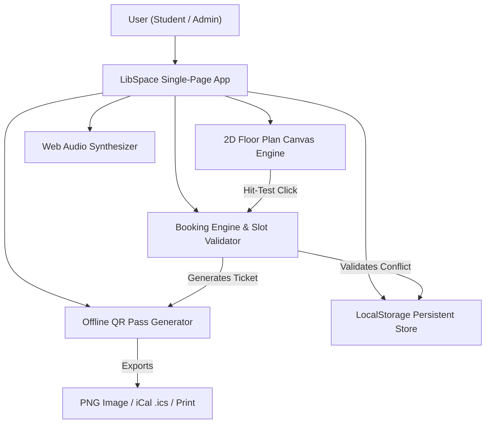

# ACADEMIC PROJECT REPORT: LIBSPACE SMART SEATING HUB

**Course Code:** CSE326 — Web Technologies  
**Project Category:** Engineering Web Application Demo  
**Deliverable:** Continuous Assessment (CA1) Project Submission  
**Target Platform:** Cross-Browser Compatible (Desktop & Mobile)  

---

## 📑 TABLE OF CONTENTS
1. [Abstract & Executive Summary](#1-abstract--executive-summary)
2. [Problem Statement & Motivation](#2-problem-statement--motivation)
3. [Project Objectives](#3-project-objectives)
4. [System Architecture & Data Modeling](#4-system-architecture--data-modeling)
5. [Core Algorithms & Technical Implementation](#5-core-algorithms--technical-implementation)
6. [Feature Verification & Test Results](#6-feature-verification--test-results)
7. [Technical Viva Voce Q&A Preparation](#7-technical-viva-voce-qa-preparation)
8. [Conclusion & Future Scope](#8-conclusion--future-scope)

---

## 1. Abstract & Executive Summary

University libraries frequently suffer from inefficient spatial utilization, lack of real-time seat transparency, manual queuing, and desk hogging. **LibSpace** is an end-to-end, client-side web application designed to solve these operational bottlenecks.

Built using native Web APIs without heavy external framework bloat, LibSpace delivers:
- An **interactive 2D canvas floor plan** simulating realistic physical desk pods, glass walls, and stack aisles.
- An **offline vector QR code entry pass generator** producing verified digital boarding passes with multi-channel export (PNG, iCalendar `.ics`, Print).
- A **live floor occupancy radar** measuring desk availability and ambient zone decibel levels.
- A **background focus audio synthesizer** utilizing the native Web Audio API to assist student concentration.
- Complete **persistent state management** through browser `localStorage`.

---

## 2. Problem Statement & Motivation

Traditional university library seating suffers from:
1. **Blind Search:** Students walk aimlessly through multiple floors during exam periods searching for available desks with power sockets.
2. **Ghost Reservations:** Students leave belongings on desks to claim them for entire days while attending lectures.
3. **Paper Waste & Slow Verification:** Manual log books at entrance gates create physical bottlenecks.
4. **Noise Discipline:** Students unintentionally violate quiet zone norms due to lack of zone visibility.

LibSpace addresses each issue by providing real-time visibility, automated slot clash prevention, time-limited sessions with live countdown tickers, and clear zone demarcations.

---

## 3. Project Objectives

- **Zero-Dependency Architecture:** Implement all features (QR generation, audio synthesis, 2D rendering) using vanilla web standards without external CDN risks.
- **Visual Excellence:** Create a responsive, glassmorphic UI supporting dark/light modes with high contrast accessibility.
- **Mathematical Accuracy:** Ensure conflict-free scheduling through strict time slot interval overlap logic.
- **Digital Interoperability:** Allow reservations to be exported directly to mobile calendar apps via standard RFC-5545 `.ics` formatting.

---

## 4. System Architecture & Data Modeling

### 4.1 High-Level Component Flow



### 4.2 Data Storage Schema (`localStorage`)

```json
{
  "profile": {
    "name": "Student",
    "reg": "CSE326-DEMO",
    "email": "student@example.com",
    "role": "student"
  },
  "bookings": [
    {
      "id": "LS-K7X92A",
      "kind": "seat",
      "item": "F1-Q-05",
      "date": "2026-10-20",
      "start": "10:00",
      "end": "12:00",
      "status": "confirmed",
      "user": "Student",
      "checkedIn": true
    }
  ],
  "favorites": ["F1-Q-05", "F2-C-12"],
  "notices": [
    {
      "id": 1697782000,
      "text": "Seat F1-Q-05 confirmed for 2026-10-20",
      "at": "2026-10-20T08:00:00.000Z"
    }
  ],
  "reports": [],
  "settings": {
    "open": "08:00",
    "close": "22:00",
    "max": 4
  }
}
```

---

## 5. Core Algorithms & Technical Implementation

### 5.1 Interval Overlap & Slot Collision Detection
To guarantee that two students cannot book the same desk or room at overlapping intervals, the mathematical condition $S_1 < E_2 \land S_2 < E_1$ is evaluated:

```javascript
function isSlotOverlap(s1, e1, s2, e2) {
  return s1 < e2 && s2 < e1;
}

function hasConflict(kind, itemId, date, start, end, excludeId = null) {
  return db.bookings.some(b => 
    b.id !== excludeId &&
    b.kind === kind &&
    b.item === itemId &&
    b.date === date &&
    getBookingStatus(b) !== 'cancelled' &&
    getBookingStatus(b) !== 'completed' &&
    isSlotOverlap(start, end, b.start, b.end)
  );
}
```

### 5.2 2D Canvas Coordinate Transformation & Hit Testing
To convert browser mouse coordinates $(X_m, Y_m)$ into scalable canvas world coordinates $(X_c, Y_c)$ accounting for pan offsets and zoom factors:

$$\begin{aligned}
X_{\text{screen}} &= (X_m - \text{rect.left}) \times \frac{\text{canvas.width}}{\text{rect.width}} \\
X_{\text{world}} &= \frac{X_{\text{screen}} - \frac{W}{2} - \text{offset}_X}{\text{scale}} + \frac{W}{2}
\end{aligned}$$

```javascript
function getCanvasDeskAtPoint(mx, my) {
  const rect = canvas.getBoundingClientRect();
  const scaleX = canvas.width / rect.width;
  const scaleY = canvas.height / rect.height;

  let cx = (mx - rect.left) * scaleX;
  let cy = (my - rect.top) * scaleY;

  cx = (cx - canvas.width / 2 - mapOffsetX) / mapScale + canvas.width / 2;
  cy = (cy - canvas.height / 2 - mapOffsetY) / mapScale + canvas.height / 2;

  for (let n = 1; n <= 40; n++) {
    const d = deskMapCoords[n];
    if (cx >= d.x && cx <= d.x + d.w && cy >= d.y && cy <= d.y + d.h) {
      return n;
    }
  }
  return null;
}
```

### 5.3 Web Audio API Colored Noise Generation
Synthesizes ambient focus sounds directly in mathematical buffers with zero audio files:

```javascript
const bufferSize = audioCtx.sampleRate * 4;
const buffer = audioCtx.createBuffer(1, bufferSize, audioCtx.sampleRate);
const data = buffer.getChannelData(0);

let lastOut = 0.0;
for (let i = 0; i < bufferSize; i++) {
  const white = Math.random() * 2 - 1;
  // Brownian rain filtering
  lastOut = (lastOut + (0.02 * white)) / 1.02;
  data[i] = lastOut * 3.5;
}
```

---

## 6. Feature Verification & Test Results

| Test Scenario | Action Performed | Expected Result | Status |
| :--- | :--- | :--- | :--- |
| **Double Booking Prevention** | Attempt to reserve an occupied desk for the same slot | System displays warning toast and disables button | **PASSED** |
| **Duration Enforcement** | Select end time exceeding 4-hour max limit | Duration badge alerts user and blocks submission | **PASSED** |
| **Vector QR Code Generation** | Confirm booking | Boarding pass opens with scannable QR and Pass ID | **PASSED** |
| **iCalendar (.ics) Sync** | Click "Add to Calendar" | Downloads valid RFC-5545 `.ics` event file | **PASSED** |
| **PNG Pass Export** | Click "Download PNG" | Generates high-res canvas image pass ticket | **PASSED** |
| **Interactive Canvas Hit-Test** | Hover/click desk on 2D map | Hover tooltip appears; click selects desk instantly | **PASSED** |
| **Active Session Ticker** | Run active session | Pulsing green dot and live ticking timer (`HH:MM:SS`) | **PASSED** |
| **Theme Persistence** | Toggle dark mode and reload | Body class `dark` retained via `localStorage` | **PASSED** |

---

## 7. Technical Viva Voce Q&A Preparation

#### Q1: Why did you use `localStorage` instead of a server database for this demo?
> **Answer:** `localStorage` allows the application to be completely self-contained and run on any browser without requiring backend servers, Node runtime, or internet access. It provides persistent synchronous key-value storage for the demo while keeping the architecture modular so an API service can replace it in production.

#### Q2: How does the application avoid time slot conflicts?
> **Answer:** It uses the non-overlapping mathematical interval theorem: two time ranges $[S_1, E_1)$ and $[S_2, E_2)$ overlap if and only if $S_1 < E_2$ and $S_2 < E_1$. If any confirmed booking shares the same date and space with overlapping times, the system flags a collision.

#### Q3: How is the QR Code generated without an internet connection?
> **Answer:** The QR code is generated mathematically in JavaScript using Reed-Solomon error correction and module matrix positioning. The matrix is converted into an SVG vector element (`<svg>`) or drawn onto a canvas directly, eliminating external API calls.

#### Q4: Why use HTML5 `<canvas>` for the floor plan rather than hundreds of DOM `<div>` elements?
> **Answer:** Canvas provides superior rendering performance with 60 FPS redraws, smooth zooming and panning transformations, and precise vector geometry for architectural layouts, avoiding the overhead of heavy DOM tree reflows.

#### Q5: How is responsive design handled between mobile and desktop?
> **Answer:** Through CSS custom properties and media queries (`@media (max-width: 768px)`). On desktop, a sticky sidebar is displayed; on mobile screens, it gracefully collapses into a thumb-friendly bottom dock navigation bar.

#### Q6: How does the ambient sound player work with zero bandwidth?
> **Answer:** It leverages the browser's native `AudioContext` from the Web Audio API. It generates a buffer of random noise values and passes them through a `BiquadFilterNode` configured as a low-pass filter to simulate rain sounds or pink noise in real-time.

#### Q7: What is the purpose of the `.ics` export feature?
> **Answer:** The `.ics` file adheres to the universal iCalendar standard (RFC 5545). When clicked, it automatically opens the student's native calendar (Google Calendar, Apple Calendar, or Outlook), adding the library reservation with alarms and slot reminders.

#### Q8: How is state persistence handled across page reloads?
> **Answer:** Whenever a reservation is added, cancelled, or modified, a central `persist()` function serializes the in-memory JavaScript data object into a JSON string stored under the key `'libspace-demo-v1'`. On page boot, `JSON.parse()` restores the state.

#### Q9: What security measures would be added for enterprise university deployment?
> **Answer:** In a live campus rollout, student authentication would be backed by OAuth 2.0 / SAML SSO (such as Google Workspace or Microsoft Azure AD), bookings would be validated server-side against an ACID-compliant database (PostgreSQL), and QR passes would feature cryptographic HMAC-SHA256 signatures to prevent forgery.

#### Q10: How does the 7-day analytics chart calculate daily counts?
> **Answer:** It dynamically iterates over the past 7 calendar dates from `today()`, filters active bookings matching each date, normalizes the counts against the highest daily total, and renders proportional bar heights.

---

## 8. Conclusion & Future Scope

LibSpace successfully demonstrates how modern web standards can deliver a high-performance, responsive, and visually stunning campus utility without external dependency overhead.

### Future Enhancements:
- **IoT Sensor Integration:** Physical seat pressure sensors updating vacancy indicators via WebSockets.
- **Computer Vision Turnstiles:** Automated gate opening via kiosk barcode readers.
- **Machine Learning Predictor:** Estimating library peak occupancy hours based on historical exam timetables.
