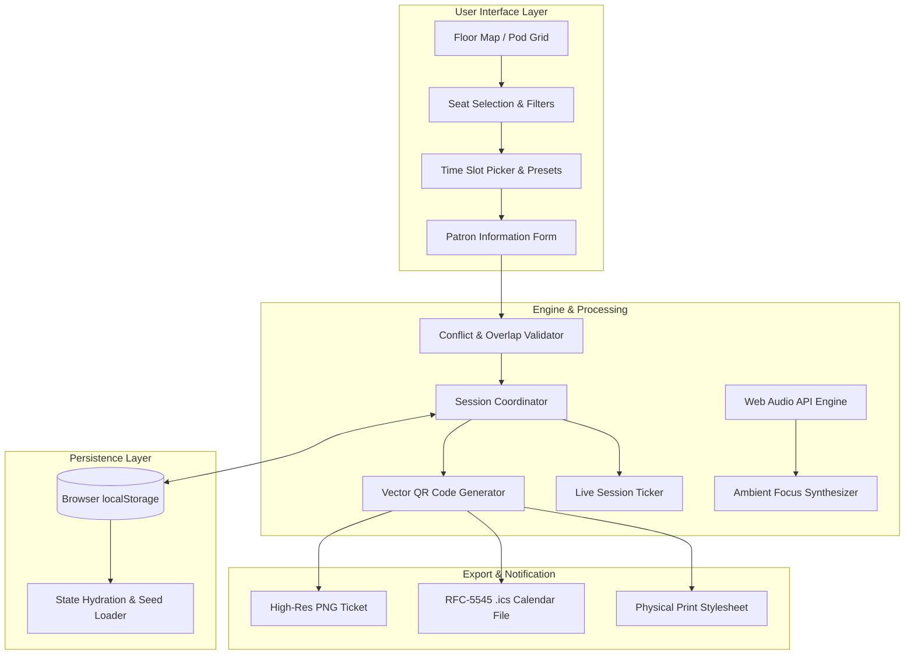

# ▣ LibSpace — Library Seat & Resource Booking System

[](https://developer.mozilla.org/en-US/docs/Web/HTML)
[](https://developer.mozilla.org/en-US/docs/Web/CSS)
[](https://developer.mozilla.org/en-US/docs/Web/JavaScript)
[](LICENSE)
[]()
[]()

> **LibSpace** is an enterprise-grade, zero-dependency smart library seat and study space reservation system built entirely with modern Vanilla Web technologies. It features an interactive 2D architectural canvas floor plan, an offline mathematical QR code pass generator, real-time noise & occupancy radar, built-in ambient focus sound synthesizer, and local persistent state management.

---

## 📌 Table of Contents

- [Overview](#-overview)
- [Key Features](#-key-features)
  - [Interactive 2D Canvas Floor Plan](#1-interactive-2d-canvas-floor-plan)
  - [Instant Digital Pass & Matrix QR Generator](#2-instant-digital-pass--matrix-qr-generator)
  - [Live Floor Occupancy Radar & Decibel Meter](#3-live-floor-occupancy-radar--decibel-meter)
  - [Real-Time Active Session Ticker](#4-real-time-active-session-ticker)
  - [Web Audio API Focus Sound Synthesizer](#5-web-audio-api-focus-sound-synthesizer)
  - [Administration & 7-Day Analytics](#6-administration--7-day-analytics)
- [System Architecture](#-system-architecture)
- [Technology Stack](#-technology-stack)
- [Project Directory Structure](#-project-directory-structure)
- [Quick Start / Installation](#-quick-start--installation)
- [User Guide & Booking Workflow](#-user-guide--booking-workflow)
- [Offline Resiliency & Data Persistence](#-offline-resiliency--data-persistence)
- [Contributing](#-contributing)
- [License & Author](#-license--author)

---

## 📖 Overview

University libraries and academic study halls frequently experience spatial bottlenecks: manual sign-in sheets, students walking aimlessly through floors searching for open electrical sockets, ghost reservations (belongings left unattended to hog desks), and unintentional noise violations.

**LibSpace** addresses these challenges through a lightweight, ultra-fast client-side single-page application (SPA). Designed with a modern dark-mode glassmorphic aesthetic, LibSpace operates completely offline with zero server setup or external package dependencies.

---

## 🌟 Key Features

### 1. Interactive 2D Canvas Floor Plan
- **Architectural Top-Down View:** Scaled 2D canvas simulation rendering physical zones (Quiet Zone, Collaborative Zone, Computer Lab), glass window facades, bookshelves, help desks, and entrance turnstiles.
- **Dynamic State Indicators:**
  - 🟢 **Available:** Ready for instant reservation.
  - 🔴 **Occupied:** Reserved by another patron with active time slot.
  - 🟣 **Selected:** User's currently highlighted desk.
  - 🟡 **Current User Reservation:** Visually linked to the user's active pass.
- **Precision Hit-Testing & Hover Tooltips:** Real-time pointer coordinate translation detecting hover and click events with sub-pixel fidelity.
- **Map Navigation:** Smooth zoom in (`+`), zoom out (`−`), and pan reset controls.
- **Dual View Modes:** Seamlessly toggle between **2D Architectural Canvas Map** and **Responsive Desk Cards Grid**.

### 2. Instant Digital Pass & Matrix QR Generator
- **Native Mathematical QR Code Engine:** Embedded pure JavaScript QR generator that converts pass metadata into scannable 2D matrix modules without external CDNs or API calls.
- **Airline Boarding Pass Styling:** Perforated card design with barcode details, verified holographic seal, patron details, zone classification, and time window.
- **Multi-Format Export:**
  - 📥 **Download PNG:** High-definition 300 DPI canvas export.
  - 📋 **Copy Pass ID:** Instant clipboard copy for library check-in counters.
  - 📅 **Add to Calendar (.ics):** Generates standard RFC-5545 `.ics` event files compatible with Google Calendar, Microsoft Outlook, and Apple Calendar.
  - 🖨️ **Print Pass:** Optimized `@media print` stylesheet for physical ticket printers.

### 3. Live Floor Occupancy Radar & Decibel Meter
- **Real-Time Capacity Metrics:** Live count of total desks, available seats, occupied seats, and power-equipped stations.
- **Zone Sound Pressure (dB) Simulation:**
  - 🟢 **Quiet Zone:** 26 dB (Strict Silence, Deep Focus)
  - 🟡 **Collaborative Zone:** 52 dB (Group Discussions, Pair Programming)
  - 🔵 **Computer Lab:** 41 dB (Workstations & Mechanical Keyboards)
- **`⚡ Recommend Best Seat` Algorithm:** Intelligently scores and selects the optimal seat matching power socket preferences, zone noise tolerance, and window view requirements.

### 4. Real-Time Active Session Ticker
- **Header Countdown Banner:** Live pulsing ticker tracking remaining session time down to the second (`HH:MM:SS`).
- **Flexible Quick Presets:** Instant selection for `+1 Hr (Now)`, `+2 Hrs (Now)`, `Morning (09:00 - 12:00)`, `Afternoon (13:00 - 16:00)`, and `Evening (17:00 - 20:00)`.
- **In-Session Controls:** One-click **+30m Extension**, **View Digital Pass**, or **Early Check-Out** to free desks for other students.
- **Collision Prevention:** Algorithmic validation preventing overlap clashes and out-of-operating-hours bookings.

### 5. Web Audio API Focus Sound Synthesizer
- Fully offline procedural sound generation running on the browser's hardware audio thread:
  - 🌧️ **Gentle Rain:** Brownian-filtered continuous acoustic noise.
  - ☕ **Library / Cafe Murmur:** Multi-bandpass filtered noise simulating distant ambient hum.
  - 🌊 **Deep Focus White Noise:** Clean Gaussian white noise spectrum for masking distractions.
- Real-time gain control slider and non-blocking toggle.

### 6. Administration & 7-Day Analytics
- **Occupancy Trends:** Interactive 7-day bookings distribution bar chart.
- **Configurable Operating Parameters:** Opening hour (`08:00`), closing hour (`22:00`), and maximum reservation duration rules.
- **Master Registry:** Comprehensive management table with administrative seat release and cancellation override.
- **Maintenance Ticketing:** Integrated reporting system for malfunctioning sockets, lighting, or broken chairs.

---

## 🏗️ System Architecture



---

## 🛠️ Technology Stack

| Layer | Technology | Details |
| :--- | :--- | :--- |
| **Markup & Semantics** | HTML5 | Accessible, semantic elements (`<main>`, `<section>`, `<nav>`, `<aside>`, `<details>`) |
| **Styling & Layout** | Vanilla CSS3 | CSS Variables, Flexbox, CSS Grid, Glassmorphic `backdrop-filter`, `@media print` |
| **Canvas Rendering** | HTML5 2D Canvas API | High-DPI crisp rendering, coordinate mapping, hover hit-testing, procedural layout |
| **Audio Synthesis** | Web Audio API | `AudioContext`, `BiquadFilterNode`, `GainNode`, `AudioBufferSourceNode` |
| **Data & Logic** | Modern JavaScript (ES6+) | Native Classes, Closures, Mathematical Matrix QR algorithms, Event Delegation |
| **Storage Engine** | Browser `localStorage` | Client-side persistent JSON key-value store with revision checks |
| **Interoperability** | RFC-5545 iCalendar | Standardized `.ics` generation for instant device calendar synchronization |

---

## 📁 Project Directory Structure

```
LibSpace-Library-Booking-System/
├── .gitignore             # Git exclusion rules (node_modules, secrets, env files)
├── index.html             # Production entry point (optimized for GitHub Pages)
├── libspace.html          # Self-contained source application
├── README.md              # Project documentation and feature showcase
└── PROJECT_REPORT.md      # Comprehensive academic submission report & Viva Q&A guide
```

---

## 🚀 Quick Start / Installation

LibSpace requires **no compilation, no `npm install`, and no database servers**.

### Option 1: Direct File Execution
1. Clone or download the repository:
   ```bash
   git clone https://github.com/vasujith007/LibSpace-Library-Booking-System.git
   cd LibSpace-Library-Booking-System
   ```
2. Simply double-click [`index.html`](file:///c:/Users/user/OneDrive/Desktop/LIB%20SEATING/index.html) (or [`libspace.html`](file:///c:/Users/user/OneDrive/Desktop/LIB%20SEATING/libspace.html)) to open it in any modern browser (Google Chrome, Mozilla Firefox, Microsoft Edge, Brave, Safari).

### Option 2: Local HTTP Server (Optional)
If using VS Code / Python / Node:
```bash
# Python 3
python -m http.server 8080

# Or Node.js npx
npx serve .
```
Navigate to `http://localhost:8080` in your web browser.

### Option 3: GitHub Pages Deployment
1. Go to your repository on GitHub.
2. Navigate to **Settings** > **Pages**.
3. Under **Branch**, select `main` and `/ (root)`.
4. Click **Save**. Your site will be live at:
   `https://vasujith007.github.io/LibSpace-Library-Booking-System/`

---

## 🎯 User Guide & Booking Workflow

1. **Explore the Floor:** Navigate the 2D architectural map or switch to the grid card view. Hover over desks to view station numbers, zone specifications, and amenities (power outlet, window side).
2. **Select an Available Desk:** Click on any 🟢 green desk. The desk will illuminate in 🟣 indigo.
3. **Choose Duration & Time Slot:** Click quick preset chips (e.g., `+2 Hrs (Now)` or `Morning 09:00 - 12:00`) or select custom start and end times.
4. **Enter Patron Credentials:** Fill in your Student Name, ID Number, and Purpose (Self Study, Project Work, Research).
5. **Confirm Reservation:** Click **Confirm Reservation**. The desk turns 🔴 occupied (and 🟡 amber for your active session).
6. **Access Entry Pass:** Your digital boarding pass displays immediately with a verified vector QR code. Download as PNG, add to your device calendar, or copy the pass ID.
7. **Manage Active Session:** Observe the real-time top banner ticker. Need more time? Click **+30m**. Finished early? Click **Check Out** to release the seat.

---

## 💾 Offline Resiliency & Data Persistence

- All reservations, configuration rules, and sound preferences are stored securely in browser `localStorage`.
- The system automatically loads pre-seeded demonstration data upon initial launch for immediate evaluation.
- No network connection is required at any time for seat reservations, QR code verification, calendar export, or audio synthesis.

---

## 🤝 Contributing

Contributions, issues, and feature suggestions are warmly welcomed!
1. Fork the Project
2. Create your Feature Branch (`git checkout -b feature/AmazingFeature`)
3. Commit your Changes (`git commit -m "feat: Add AmazingFeature"`)
4. Push to the Branch (`git push origin feature/AmazingFeature`)
5. Open a Pull Request

---

## 📄 License & Academic Attribution

This project is open-source and distributed under the **MIT License**. Created as part of the academic curriculum for **CSE326 — Web Technologies**.
